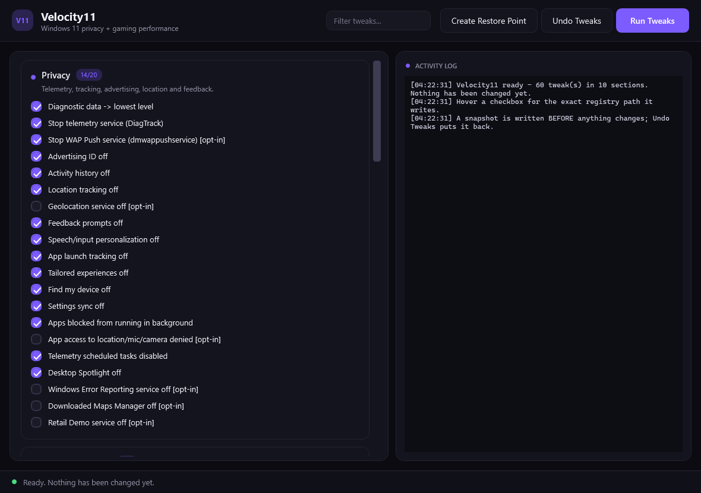
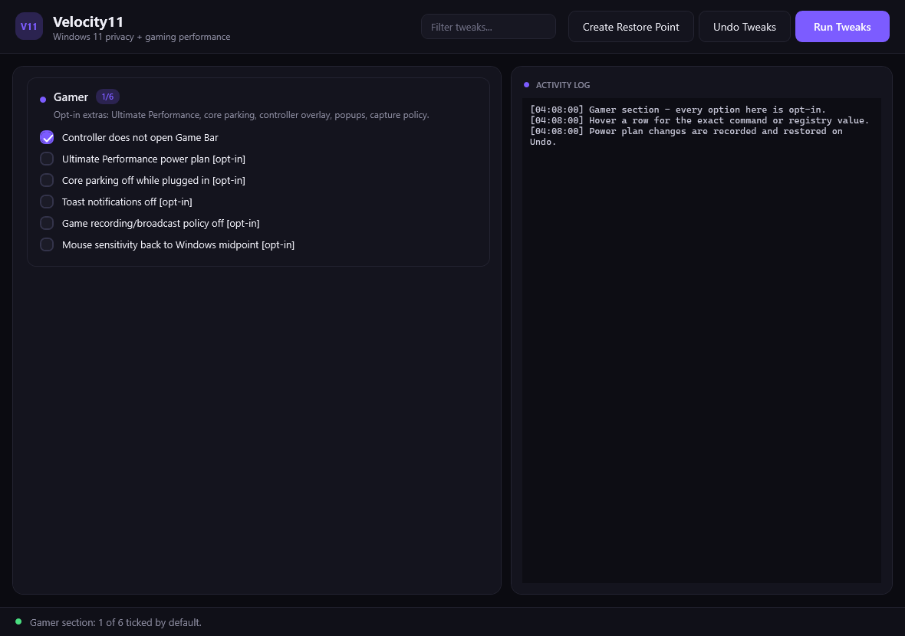

# Velocity11

Privacy, telemetry and gaming-performance tuning for Windows 11 - one double-click, and **every single change reversible**.



## What it does

**60 tweaks across 10 sections**, each one a checkbox with a tooltip that tells you the exact registry key, value name and data type it will write (and whether Microsoft actually documents it):

| Section | Examples |
| --- | --- |
| Privacy | telemetry level, DiagTrack, advertising ID, activity history, location, Find My Device, settings sync, background apps, telemetry scheduled tasks, desktop Spotlight |
| Search & widgets | web results in Start, Cortana, Explorer search suggestions, Widgets pane |
| Suggestions & lock screen | promoted/suggested apps, silent installs, Windows tips, Spotlight, lock-screen notifications |
| Gaming | Game Mode, background recording (Game DVR), hardware-accelerated GPU scheduling, mouse/key latency |
| Power & graphics | High-performance plan, Fast Startup, visual effects, TRIM, PCIe link-state power, USB selective suspend, SysMain |
| Responsiveness | transparency effects, window animations, menu delay, startup delay, MMCSS game profile |
| Network | update peer-to-peer sharing, Nagle off on active adapters |
| Windows Update | no auto-restart while signed in, 35-day pause, notify before download |
| Bloatware | preinstalled app removal (Store, Xbox and frameworks are never touched), optional OneDrive uninstall |
| Gamer | **opt-in extras**: Ultimate Performance plan, core parking off, controller no longer opens Game Bar, toast notifications off, Game DVR policy, mouse back to the Windows midpoint |



Tweaks that have a real chance of breaking something you use - WAP Push, geolocation service, SysMain, WER, Maps, Retail Demo, camera/mic/location denial, OneDrive, and five of the six Gamer options - ship **unticked** and stay off unless you ask. The whole Gamer section is opt-in by design: Ultimate Performance and core parking change power draw and heat, toast-off kills every app popup, and none of them should be applied behind your back.

## Safety model

1. **Snapshot first, always.** Before the first value is written, Velocity11 creates `snapshots\<timestamp>\` containing `state.json` (the exact previous value of every key it is about to touch, *including "this value did not exist"*, plus service start modes, power-plan GUID, power-setting indices, scheduled-task states), `reg.exe` exports of every touched key, and `changes.log`.
2. **It refuses to run without a writable snapshot folder.** A write-protected USB stick aborts with *"Nothing was changed"* instead of applying tweaks it could not roll back.
3. **Confirmation before apply**, plus a `Create Restore Point` button for a system-level safety net.
4. **`Undo Tweaks`** walks the snapshot in reverse: values it created are deleted, values it changed go back to the recorded value, services and power settings are restored, disabled tasks are re-enabled.

## Quick start

Copy `Velocity11.cmd` and `Velocity11.ps1` anywhere (a USB stick works) and double-click `Velocity11.cmd`.

- Accept the UAC prompt to get the fully working window. Declining still opens it - `Run Tweaks` then explains that it needs administrator rights.
- Nothing is installed, no system execution policy is changed (`-ExecutionPolicy Bypass` is process-scoped only), and the drive letter does not matter.

### Command line

```powershell
Velocity11.cmd                  # GUI (default)
Velocity11.cmd -Menu            # numbered console menu instead of the GUI
Velocity11.cmd -List            # print the tweak catalogue and exit (no admin needed)
Velocity11.cmd -Details         # registry-level detail for every tweak
Velocity11.cmd -Apply           # apply the default selection non-interactively
Velocity11.cmd -Revert          # restore the most recent snapshot
Velocity11.cmd -Revert -Snapshot "snapshots\20261025-101500"
```

## Requirements

Windows 10 or 11 with the Windows PowerShell 5.1 that ships with it. No PowerShell 7, no .NET SDK, no package manager, no network access.

## Verification status

Every tweak carries its evidence in its tooltip. Roughly:

- **Documented by Microsoft** (telemetry policy, LocationAndSensors, Windows Search policies, DeliveryOptimization, `AUOptions`, `NoAutoRebootWithLoggedOnUsers`, AppPrivacy policies, SettingSync, FindMyDevice, `TcpAckFrequency`, power-setting GUIDs, `fsutil` delete-notify, MMCSS `SystemResponsiveness`, ...) - behaviour described from Microsoft Learn.
- **Long-standing but undocumented** (`EnableTransparency`, `MinAnimate`, `MenuShowDelay`, `StartupDelayInMSec`, `VisualFXSetting`, `HwSchMode`, `NetworkThrottlingIndex`, `TCPNoDelay`, the `ContentDeliveryManager` values, the Windows Update pause values, USB power GUIDs) - labelled as such in the tooltip rather than presented as official.

Nothing here is applied silently: if a setting does not exist on your machine, it is skipped and logged, never written blind.

## Development

```powershell
# from the repository root - builds nothing, just verifies the tool
powershell -NoProfile -STA -ExecutionPolicy Bypass -File tests\harness.ps1
```

The harness renders the window **without showing it**, checks that all 60 checkboxes and 10 cards build, that checkbox state round-trips into the tweak catalogue, that the Gamer section ships with exactly one option ticked, that the filter box narrows and restores the list, that the log pane receives output, renders `preview.png`, and exercises the apply/revert engine against a scratch `HKCU` key that it deletes afterwards. It never touches a real setting.

## Repository layout

| File | Purpose |
| --- | --- |
| `Velocity11.cmd` | double-click launcher (resolves its own folder, forces `-STA` + `-ExecutionPolicy Bypass`, keeps the window open on error) |
| `Velocity11.ps1` | the whole tool: tweak catalogue, snapshot/apply/revert engine, GUI and console menu |
| `tests/harness.ps1` | verification harness (see above) |
| `preview.png`, `preview-gamer.png` | screenshots of the GUI and the Gamer section, rendered from the real XAML (the window is never shown) |
| `LICENSE` | MIT |
| `DISCLAIMER.md` | **read this first** - what the tool changes, its limits, and overclocking/hardware caveats |

## Contributing

Issues and PRs welcome. Please:

1. Verify any new registry value against Microsoft Learn (or say plainly in the tooltip that it is third-party folklore) - an honest `UNVERIFIED` beats a confident wrong claim.
2. Make new tweaks **revertible**: use `Set-V11RegValue`, `Set-V11Service`, `Disable-V11Task`, `Set-V11PowerSetting` or add a new state `Kind` with a matching case in `Restore-V11Snapshot`.
3. Ship anything risky as `Default = $false` (an `[opt-in]` tweak).
4. Run `tests\harness.ps1` before opening a PR.

## License

[MIT](LICENSE)

## Disclaimer

Velocity11 changes **registry values, services, power plans, scheduled tasks and installed applications** on your machine. It is supplied **"as is" with no warranty**, and nobody involved is liable for damage, data loss or downtime. Snapshots and restore points are recovery aids, not a backup - you are responsible for reviewing what you tick and for keeping your own backups. Overclocking and hardware guidance in this repository is general information, not professional engineering or warranty advice. This project is not affiliated with Microsoft, NVIDIA, AMD or Intel.

**Read [DISCLAIMER.md](DISCLAIMER.md) in full before using it.**

## Acknowledgements

- The GUI layout and the *Run / Undo / Restore Point* interaction are inspired by Chris Titus Tech's Windows Utility.
- Registry semantics were checked against [Microsoft Learn](https://learn.microsoft.com/windows/) wherever a documented source exists.
- Not affiliated with Microsoft; Windows is a trademark of Microsoft Corporation.
# Velocity11
